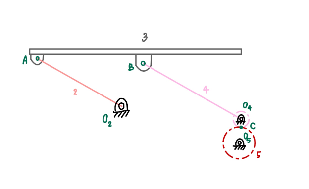

# Mechanical Engineering Project Template

A reusable starting point for projects in the Mechanical Engineering Department. Use this repository as a template to organize a project’s mechanical design, electronics, software, machine skills, simulation, documentation, experiments, and publications.

## Getting started

1. Select **Use this template** on GitHub to create a repository for your project.
2. Rename the project in this README and update the project summary, team, and objectives.
3. Review the folder READMEs and replace the examples with project-specific information.
4. Create GitHub Issues for tasks and record important design decisions and test results.
5. Check the license placeholder and select appropriate terms before sharing or reusing project work.

## Project overview

- **Project name:** Bus Swing-Plug Door Mechanism
- **Problem / purpose:** Conventional inward-folding bus doors intrude into the passenger cabin and reduce standing capacity near the entrance, while standard outward-swinging hinged doors require a wide external clearance radius that poses a collision hazard in tight urban stops. This project simulates a swing-plug bus door mechanism that translates the door panel smoothly outward, maximizing interior cabin space while minimizing the exterior swing envelope.
- **Team:**\
            1. 6730305221 Pannaporn Kawil (Symbolic Mathematics)\
            2. 6730376821 Pimmada Phayoongtham (Multibody Simulation)\
            3. 6730547821 Suphitchaya Kongthai (Physical Prototyping)
- **Status:** Planning
- **Last updated:** [YYYY-MM-DD]

## Repository structure

| Path | Purpose |
|---|---|
| `hardware/mechanical/` | CAD models, drawings, and fabrication files |
| `hardware/bom.csv` | Bill of materials with quantities, units, and sourcing details |
| `simulation/` | Models, scripts, assumptions, and simulation results |
| `docs/` | Assembly, setup, operation, and maintenance instructions |
| `media/` | Images, GIFs, and links to demonstration videos |
| `publications/` | Project-related journal and conference papers |

## Kinematic Model

As shown in the kinematic diagram, the outward-plug bus door is a planar 5-link, 1-DOF gear-driven parallelogram linkage that swings the door outward without rotating the panel. The stationary bus frame (Link 1: wall, floor, and motor) supports three fixed pivots: floor pivot O2, wall pivot O4, and motor axis O5. The motor drives the input spur gear (Link 5: driving gear, Z = 30) at O5, which meshes at pitch point C with the driven gear (Link 4: driven gear and rod, Z = 15) at O4 for a 1:2 speed step-up. Because Link 4 is paired with the equal-length lower follower link (Link 2: bottom link), the bus door (Link 3: door) undergoes pure curvilinear translation. The mechanism contains n = 5 links, j1 = 5 revolute pairs (O2, O4, O5, A, B), and j2 = 1 roll-slide gear pair (C).

### Kinematic Pairs
* **Prismatic:** —
* **Revolute:** O2, O4, O5, A, B
* **Rolling:** —
* **Roll-slide (Gear Mesh):** C

### Mobility (Grübler's Equation)
* **Total links:** n = 5
* **Lower pairs:** j1 = 5
* **Higher pairs:** j2 = 1
  
**M = 3(n − 1) − 2j1 − j2 = 3(5 − 1) − 2(5) − 1 = 1 DOF**

**Workspace:** Across the 0° to 160° crank sweep, every point on the door traces an identical circular arc with a single-point lateral displacement of Δx = 172.8 mm and a peak outward clearance of Δymax = 89.0 mm (settling at Δyopen = 29.8 mm when fully open). Accounting for the width of the door panel, the total swept physical workspace spans Δxtotal = 341.1 mm horizontally by 89.0 mm outward.

## Collaboration and file practices

Use descriptive filenames and commit messages. Record units, revisions, software versions, and assumptions. Keep editable source files where practical. Avoid committing credentials, private data, temporary files, or duplicate exports. Consider Git LFS for large CAD, simulation, and video files.

## Safety and validation

Document hazards, safeguards, and operating limits before testing hardware. Validate important calculations and simulation results against measurements where practical.
