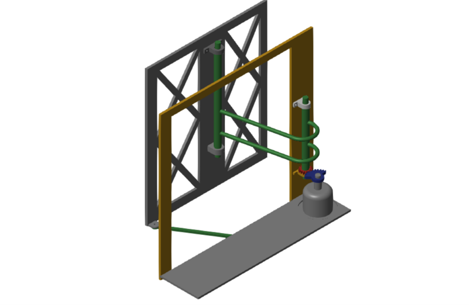
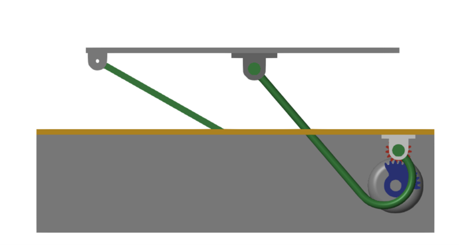
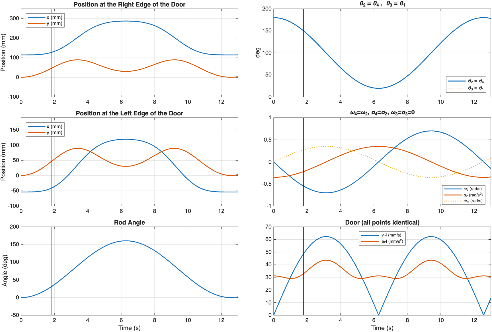

# Simulation

## Simscape Multibody Analysis

  A 3D multibody model was constructed in MATLAB (R2026a) Simscape Multibody using imported CAD geometries aligned to exact pivot axes. The ground bodies, which are wall, motor, and floor, are anchored to World Frame, Solver Configuration, and Mechanism Configuration. From these bodies, the parallel kinematic chains connect to the door panel to form a closed-loop 4-bar mechanism.
      
  The motor connects to the driving gear (Z = 30) via an actuated revolute joint driven by a sinusoidal angle input (kinematic simplification prescribed motion input). The driving gear meshes with the driven gear (Z=15) through a common gear constraint with 1:2 ratio (Follower-to-Base teeth ratio), and the driven gear rigidly attaches to the rod on the door to transmit rotational drive. The rod is also pivoted to the wall via a revolute joint. The floor connects through a revolute joint to the bottom link, while the opposite end of the link connects via a second revolute joint to the door. The rod connects via a revolute joint to the door closing the parallelogram loop.

| Isometric 3D Assembly | Top-Down Layout View |
| :---: | :---: |
|  |  |

* **3D Isometric Simulation Video:** [`3d_simulation.avi`](../media/3d_simulation.avi)
* **Top-View Simulation Video:** [`3d_simulation_top_view.avi`](../media/3d_simulation_top_view.avi)

### Modeling Assumptions

  To isolate the kinematic behavior of the mechanism and ensure identical boundary conditions with the symbolic analysis, the following modeling assumptions were applied:
-	All revolute joints are assumed frictionless with zero radial pin clearance, and the Common Gear Constraint enforces an exact 1:2 kinematic ratio without tooth backlash, sliding friction, or deflection. 
-	A relaxed solver consistency tolerance was applied to accommodate minor CAD center-distance rounding tolerances between the meshing gear axes.
-	Electro-mechanical motor dynamics and torque limits are neglected in favor of an idealized sinusoidal angular position input. 

### Simulation Results

  With the prescribed sinusoidal wave (ω = 0.5 rad/s), the simulation was executed over a complete 12.6 s opening-and-closing cycle. The door swings outward along a smooth circular arc before tucking into the open position, yielding a net lateral opening width of ∆x = 172.8 mm, a peak outward clearance of ∆y_max = 89 mm, and a fully open outward offset of ∆y_open = 29.8 mm. Both right edge and left edge of the door undergo identical net lateral displacements and identical clearance across the 0° to 160° crank sweep. As both edges maintain a constant relative spacing at every instant, the door remains parallel to the wall with zero angular rotation.

| 2D Door Trajectory (X vs. Y) | Position & Rod Angle vs. Time |
| :---: | :---: |
|  |  |

### Instructions for Reproducing Results

1. **Clone or download** the repository to your local computer.
2. Open **MATLAB R2026a** and set the Current Folder to the repository root directory.
3. Right-click both `simulation/` and `hardware/mechanical/` → **Add to Path** → **Selected Folders and Subfolders** so Simscape locates all `.step` CAD files.
4. Open `simulation/multibody_bus_door_analysis.slx`, and click **Run** to launch the 3D Mechanics Explorer animation and update the **Scope** and **XY Graph** plots.
5. Open `simulation/Mechanism.mlx` and click **Run All** to generate the symbolic kinematic verification plots.

# Symbolic Kinematic Analysis

A symbolic kinematic analysis of the door mechanism was carried out in MATLAB Symbolic Math Toolbox to obtain closed-form expressions for the position, velocity, and acceleration of every link and of the door panel. Forces and inertia are not considered. All link lengths and pivot locations were taken directly from the B-rep of the CAD model (redo2.step), and the input motion is the same sinusoidal motor angle used in the Simscape Multibody model, so both analyses share identical geometry and boundary conditions.
All pivot axes are parallel to the CAD z-axis, so the mechanism moves in the XY plane (top view). Angles are measured counter-clockwise from the +X axis and lengths are in millimetres, expressed in the global coordinates of the STEP file.
Link Dimensions (Closed Position)	Vector Loop (θ₂ = 110°)
Link Dimensions	Vector Loop
## Geometry from CAD
The pivot locations are the centres of the circular pin and bore edges of each part. 
Opposite links have equal length ($r_1 = r_3$, $r_2 = r_4$), confirming that the mechanism is a parallelogram four-bar linkage.

Point	Part	X (mm)	Y (mm)
O₂	Rod shaft / driven gear (Z = 15)	125.788	−9.433
A	Door pin on rod	36.793	−9.433
O₄	Bottom link pin on floor	41.577	−5.223
B	Door pin on bottom link	−47.417	−5.223
M	Motor shaft / driving gear (Z = 30)	124.257	−28.318
Link	Part	Length (mm)	Angle at Closed Position
$r_1$	Ground (O₂ → O₄)	84.316	$\theta_1$ = 177.138°
$r_2$	Rod, input crank (O₂ → A)	88.995	$\theta_2$ = 180°
$r_3$	Door, coupler (A → B)	84.316	$\theta_3$ = 177.138°
$r_4$	Bottom link, rocker (O₄ → B)	88.995	$\theta_4$ = 180°

## Modeling Assumptions
To match the Simscape Multibody model, the following assumptions were applied:

All bodies are rigid and all revolute joints are frictionless with zero pin clearance.
The gear pair enforces an exact 1:2 kinematic ratio without backlash.
Forces, masses, and motor dynamics are neglected; the motor angle is a prescribed sinusoidal input.
At t = 0 the door is fully closed ($\theta_2 = 180^\circ$).
## Position Analysis

The four links form a closed loop, so the vector sum around O₂ → A → B → O₄ → O₂ must vanish:

$$\mathbf{R}_2+\mathbf{R}_3-\mathbf{R}_4-\mathbf{R}_1=\mathbf{0}$$
$$\begin{aligned}
r_2\cos\theta_2+r_3\cos\theta_3-r_4\cos\theta_4-r_1\cos\theta_1&=0\\
r_2\sin\theta_2+r_3\sin\theta_3-r_4\sin\theta_4-r_1\sin\theta_1&=0
\end{aligned}$$

Substituting the parallelogram condition $r_3 = r_1$, $r_4 = r_2$ shows that the loop is satisfied for every input angle by

$$\theta_3=\theta_1=177.138^\circ\ (\text{constant}),\qquad \theta_4=\theta_2$$

The door therefore translates without rotating, and every point on it moves by the same displacement as pin A:

$$\mathbf{r}_A=r_2\begin{bmatrix}\cos\theta_2\\ \sin\theta_2\end{bmatrix},\qquad
\mathbf{r}_{\text{door}}(t)=\mathbf{r}_{\text{door}}(0)+\left[\mathbf{r}_A(t)-\mathbf{r}_A(0)\right]$$
## Velocity Analysis

Differentiating the loop equations with respect to time gives a linear system in $\omega_3$ and $\omega_4$:

$$\begin{bmatrix}-r_3\sin\theta_3 & r_4\sin\theta_4\\ r_3\cos\theta_3 & -r_4\cos\theta_4\end{bmatrix}
\begin{bmatrix}\omega_3\\ \omega_4\end{bmatrix}=
\begin{bmatrix}r_2\omega_2\sin\theta_2\\ -r_2\omega_2\cos\theta_2\end{bmatrix}$$
$$\omega_3=\frac{r_2\,\omega_2\sin(\theta_4-\theta_2)}{r_3\sin(\theta_3-\theta_4)},\qquad
\omega_4=\frac{r_2\,\omega_2\sin(\theta_2-\theta_3)}{r_4\sin(\theta_4-\theta_3)}$$

For the parallelogram this reduces to $\omega_3 = 0$ and $\omega_4 = \omega_2$, and the door velocity is

$$\mathbf{v}_{\text{door}}=r_2\,\omega_2\begin{bmatrix}-\sin\theta_2\\ \cos\theta_2\end{bmatrix},\qquad \left|\mathbf{v}_{\text{door}}\right|=r_2\left|\omega_2\right|$$
## Acceleration Analysis

Differentiating a second time gives a linear system in $\alpha_3$ and $\alpha_4$ with the same coefficient matrix:

$$\begin{aligned}
A&=r_4\sin\theta_4,\quad B=r_3\sin\theta_3,\quad D=r_4\cos\theta_4,\quad E=r_3\cos\theta_3\\
C&=r_2\alpha_2\sin\theta_2+r_2\omega_2^2\cos\theta_2+r_3\omega_3^2\cos\theta_3-r_4\omega_4^2\cos\theta_4\\
F&=r_2\alpha_2\cos\theta_2-r_2\omega_2^2\sin\theta_2-r_3\omega_3^2\sin\theta_3+r_4\omega_4^2\sin\theta_4\\
\alpha_3&=\frac{CD-AF}{AE-BD},\qquad \alpha_4=\frac{CE-BF}{AE-BD}
\end{aligned}$$

For the parallelogram this reduces to $\alpha_3 = 0$ and $\alpha_4 = \alpha_2$. The door acceleration has a tangential and a normal component:

$$\mathbf{a}_{\text{door}}=r_2\,\alpha_2\begin{bmatrix}-\sin\theta_2\\ \cos\theta_2\end{bmatrix}-r_2\,\omega_2^2\begin{bmatrix}\cos\theta_2\\ \sin\theta_2\end{bmatrix},\qquad
\left|\mathbf{a}_{\text{door}}\right|=r_2\sqrt{\alpha_2^2+\omega_2^4}$$
## Input Motion

The motor angle is the same sinusoidal input used in Simscape ($A_m$ = 0.7 rad, $\Omega$ = 0.5 rad/s, $\phi$ = 3π/2 rad). The phase starts the motor at its extreme position with zero velocity, which corresponds to the closed door. The gear pair (Z = 30 driving Z = 15) doubles the angle and reverses the direction:

$$\theta_m(t)=0.7\sin\left(0.5t+\tfrac{3\pi}{2}\right)=-0.7\cos(0.5t),\qquad
\theta_2(t)=\pi-\frac{N_{30}}{N_{15}}\left[\theta_m(t)-\theta_m(0)\right]$$
$$\theta_2(t)=\pi-1.4\left(1-\cos 0.5t\right),\qquad
\omega_2(t)=-0.7\sin(0.5t),\qquad
\alpha_2(t)=-0.35\cos(0.5t)$$

Gear Train Detail

## Analysis Results

Over one 12.6 s cycle the rod sweeps 160.43° (θ₂ from 180° to 19.57°) and returns. The door translates along a circular arc of radius $r_2$ = 88.995 mm, giving a net lateral opening width of ∆x = 172.8 mm, a peak outward clearance of ∆y_max = 89.0 mm at t = 3.39 s, and a fully open outward offset of ∆y_open = 29.8 mm. The door reaches its maximum speed of 62.30 mm/s and maximum acceleration of 43.61 mm/s² at t = π s, when the rod passes θ₂ ≈ 100°. The door angular velocity and acceleration are zero throughout ($\omega_3 = \alpha_3 = 0$).

Quantity	Maximum	Time (s)
Rod angular velocity |ω₂| = |ω₄|	0.700 rad/s	π, 3π
Rod angular acceleration |α₂| = |α₄|	0.350 rad/s²	0, 2π, 4π
Motor angular velocity |ωₘ|	0.350 rad/s	π, 3π
Door speed |v|	62.30 mm/s	π, 3π
Door acceleration |a|	43.61 mm/s²	π, 3π
## Change Point

The general solutions contain $\sin(\theta_3-\theta_4)$ in the denominator, which vanishes when all four links are collinear at $\theta_2 = \theta_1 = 177.138^\circ$ (t ≈ 0.536 s and t ≈ 12.030 s). At this change point the general expressions become 0/0 and a physical parallelogram linkage may switch to the crossed (anti-parallelogram) branch. The analysis follows the parallelogram branch defined by the CAD assembly, for which $\omega_3 = 0$, $\omega_4 = \omega_2$, $\alpha_3 = 0$, and $\alpha_4 = \alpha_2$ remain valid through the change point.

Verification against Simscape Multibody
Quantity	Symbolic Analysis	Simscape Multibody
Net lateral opening width ∆x	172.8 mm	172.8 mm
Peak outward clearance ∆y_max	89.0 mm	89 mm
Fully open outward offset ∆y_open	29.8 mm	29.8 mm
Crank sweep	160.43°	0° to 160°
Door rotation	0	0

The symbolic results agree with the Simscape Multibody simulation, confirming the closed-form kinematic model.

 |  
