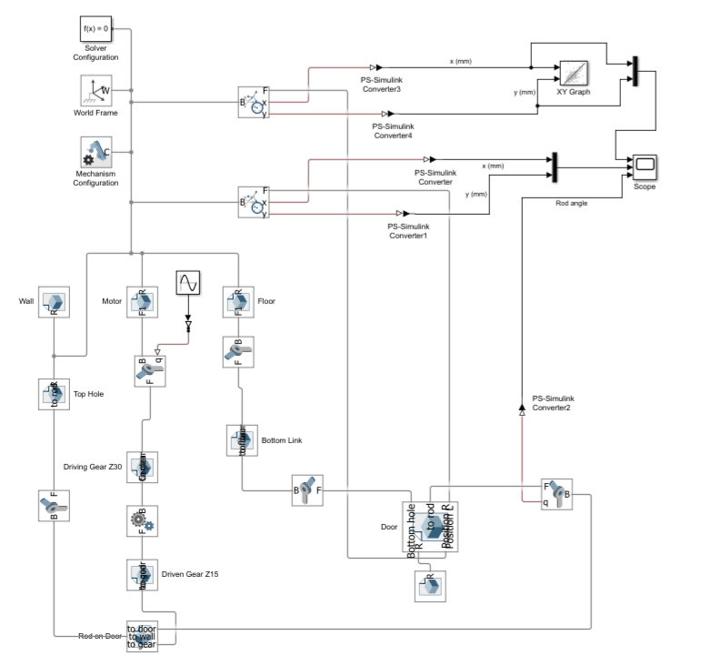
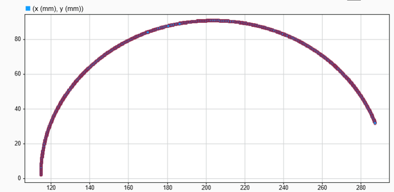
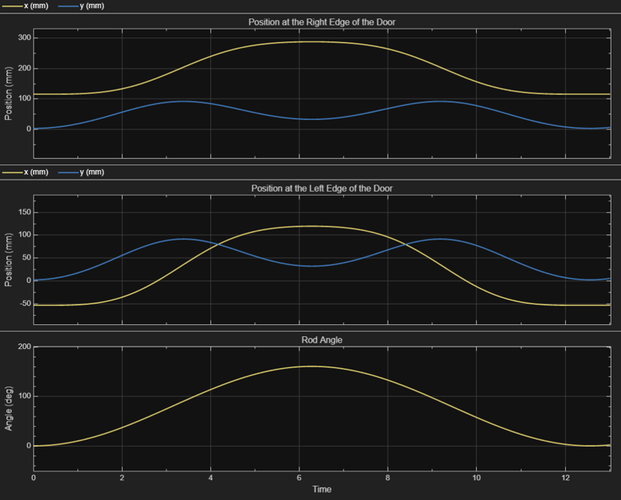

# Simulation

## Simscape Multibody Analysis

  A 3D multibody model was constructed in MATLAB (R2026a) Simscape Multibody using imported CAD geometries aligned to exact pivot axes. The ground bodies, which are wall, motor, and floor, are anchored to World Frame, Solver Configuration, and Mechanism Configuration. From these bodies, the parallel kinematic chains connect to the door panel to form a closed-loop 4-bar mechanism.
      
  The motor connects to the driving gear (Z = 30) via an actuated revolute joint driven by a sinusoidal angle input (kinematic simplification prescribed motion input). The driving gear meshes with the driven gear (Z=15) through a common gear constraint with 1:2 ratio (Follower-to-Base teeth ratio), and the driven gear rigidly attaches to the rod on the door to transmit rotational drive. The rod is also pivoted to the wall via a revolute joint. The floor connects through a revolute joint to the bottom link, while the opposite end of the link connects via a second revolute joint to the door. The rod connects via a revolute joint to the door closing the parallelogram loop.

| Isometric 3D Assembly | Top-Down Layout View |
| :---: | :---: |
|  |  |

* **3D Isometric Simulation Video:** [`3d_simulation.avi`](../media/3d_simulation.avi)
* **Top-View Simulation Video:** [`3d_simulation_top_view.avi`](../media/3d_simulation_top_view.avi)

### Modeling Assumptions

  To isolate the kinematic behavior of the mechanism and ensure identical boundary conditions with the symbolic analysis, the following modeling assumptions were applied:
-	All revolute joints are assumed frictionless with zero radial pin clearance, and the Common Gear Constraint enforces an exact 1:2 kinematic ratio without tooth backlash, sliding friction, or deflection. 
-	A relaxed solver consistency tolerance was applied to accommodate minor CAD center-distance rounding tolerances between the meshing gear axes.
-	Electro-mechanical motor dynamics and torque limits are neglected in favor of an idealized sinusoidal angular position input. 

### Simulation Results

  With the prescribed sinusoidal wave (ω = 0.5 rad/s), the simulation was executed over a complete 12.6 s opening-and-closing cycle. The door swings outward along a smooth circular arc before tucking into the open position, yielding a net lateral opening width of ∆x = 172.8 mm, a peak outward clearance of ∆y_max = 89 mm, and a fully open outward offset of ∆y_open = 29.8 mm. Both right edge and left edge of the door undergo identical net lateral displacements and identical clearance across the 0° to 160° crank sweep. As both edges maintain a constant relative spacing at every instant, the door remains parallel to the wall with zero angular rotation.

| 2D Door Trajectory (X vs. Y) | Position & Rod Angle vs. Time |
| :---: | :---: |
|  |  |

### Instructions for Reproducing Results

1. **Clone or download** the repository to your local computer.
2. Open **MATLAB R2026a** and set the Current Folder to the repository root directory.
3. Right-click both `simulation/` and `hardware/mechanical/` → **Add to Path** → **Selected Folders and Subfolders** so Simscape locates all `.step` CAD files.
4. Open `simulation/multibody_bus_door_analysis.slx`, and click **Run** to launch the 3D Mechanics Explorer animation and update the **Scope** and **XY Graph** plots.
5. Open `simulation/Mechanism.mlx` and click **Run All** to generate the symbolic kinematic verification plots.
